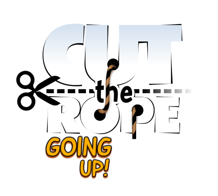
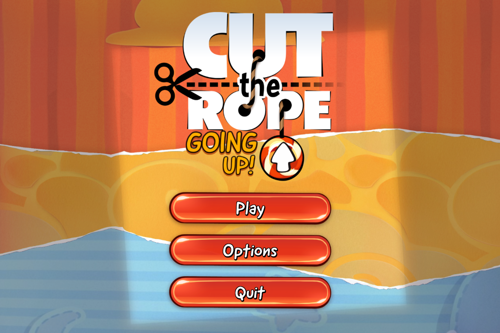

# Cut the Rope: DX - Going UP!

  

## About

_Cut the Rope: DX (Decompiled Extra)_ is a fan-made enhancement of the PC version of _Cut the Rope_, originally developed by ZeptoLab. This project aims to improve the original game's codebase, add new features, and enhance the overall gaming experience.

The game's source code is decompiled from the PC version, which serves as the foundation for development and feature expansion.

Going UP! Theme Is A 2026 Community Contest Moderate By aidrum To Create A Level With Going Up Theme.

This project is a part of the [_Cut the Rope Home_](https://ctrhome.github.io/fan-projects/) fan project, and is currently led by [yell0wsuit](https://github.com/yell0wsuit), with help from [contributors](https://github.com/yell0wsuit/cuttherope-dx/graphs/contributors).

The DX logo is designed by Bingies24 and darealmrcatz.

> [!NOTE]
> This project is not, and will never be affiliated with or endorsed by ZeptoLab. All rights to the original game and its assets belong to ZeptoLab.

### Related projects by yell0wsuit

- [Cut the Rope DX](https://github.com/yell0wsuit/cuttherope-dx): Cut the Rope DX, a fan-made enhancement of the PC version of Cut the Rope.
- [Cut the Rope DX: Level Editor](https://github.com/yell0wsuit/ctrdx-editor/): a standalone app for creating and editing levels for Cut the Rope: DX.

  

## Contestants Level List

Level 1 - Reach to the Top! by BurgerDude
Level 2 - What an Extreme by Samir_2ac
Level 3 - No ropes?!?! No bubbles?!?! No gravity button?!?! by Карапет
Level 4 - Sweet-syphus Much? by Agent Zero
Level 5 - Thrown Aside by koxoo
Level 6 - Tower That Up! by TetenAnimationz19742
Level 7 - Go up! by 6danieltest
Level 8 - Artificial Ascent by popcow
Level 9 - The (Almost) Everything Tower by blumburt
Level 10 - Climbing Up by Matheus
Level 11 - Elevator of Pain by It's Me, Lis!
Level 12 - Kaizo Medium by Bro Nom
Level 13 - Hellevator by Hitspace
Level 14 - Bathhouse Tower by Crutter_Botch
Level 15 - Heaven Wasn't Painfull Enough... by Limeapple 
Level 16 - Dis candy, goin' up! by Milkas
Level 17 - The Rise and Fall by Matheus Lopes
Level 18 - sunrise by binnyy7
Level 19 - Mechanic Ocean by SwordJhon
Level 20 - Forbidden Bounce by DarkTheCreature

## Download

Download the latest release from the [Releases page](https://github.com/itsme-lis/cuttheropedx-goingup/releases/tag/Releases).

## Features

- 20 Levels Of Going UP! Theme From Our Contestant
- Custom Box Themes & Candies Of Each Levels
- Custom Music Theme
- Contestant Levels Credits
- Other Going UP! Theme

## Patches

- Level 10 & Level 20 Instant Camera Transition
- Fixing Level 20 Spam SFX
